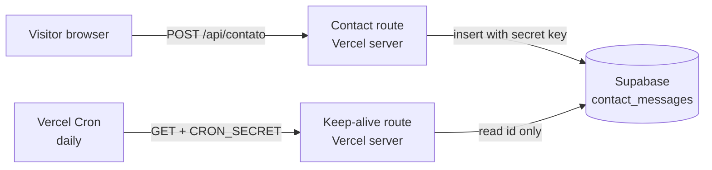

# Analice Ferreira — Portfolio

Portfolio website for Analice Ferreira, AI Automation Engineer.

**Live:** https://analiceferreira.com.br

## Overview

For companies looking to hire and clients who need AI automation solutions.
Visitors can explore services and projects, and get in touch via the contact form or WhatsApp.

Technical highlights:

- Contact form backed by Supabase with RLS and least-privilege access (secret key kept server-side)
- Security headers (CSP) validated in production
- Daily cron that keeps the free-tier database active

## Architecture



**Contact form:** the contact route drops bots via a honeypot field, validates every field, and inserts the message using the Supabase secret key, which never reaches the browser. The database enforces the same length limits again as a second layer.

**Keep-alive:** once a day, Vercel Cron calls the keep-alive route. The route checks `CRON_SECRET` first (401 otherwise) and then runs a minimal read, so the free-tier project is never paused for inactivity.


## Tech stack

- **Next.js 16** (App Router): pages and server-side API routes
- **React 19**: user interface
- **TypeScript**: static typing across the codebase
- **Supabase** (PostgreSQL): stores contact form messages
- **Vercel**: hosting, automatic deploys from `main`, and the daily cron

## Security

- **Row Level Security (RLS):** enabled on `contact_messages` with no public policies, so the public (anon) key can neither read nor write messages.
- **Least privilege:** the server key can only insert messages and read the `id` column. Even if it leaked, contact data could not be read with it.
- **Secrets stay server-side:** keys live in `.env.local` (git-ignored) and in Vercel secret environment variables, never with the `NEXT_PUBLIC_` prefix, so they never reach the browser.
- **Defense in depth:** the API route validates every field, and the database enforces the same length limits through `CHECK` constraints.
- **Spam protection:** a hidden honeypot field silently drops bot submissions.
- **Rate limiting:** a Vercel Firewall rule allows 5 contact submissions per IP every 10 minutes; extra requests get 429 at the edge, before reaching the route ([ADR 0004](docs/adr/0004-rate-limit-with-vercel-firewall.md)).
- **Security headers:** Content-Security-Policy, X-Frame-Options, X-Content-Type-Options, Referrer-Policy, and Permissions-Policy on every route, validated in production with `curl -I`.
- **Authenticated cron:** the keep-alive route rejects any request without the correct `CRON_SECRET` (401).


## Engineering approach

This project is built with AI assistance (Claude Code). I own the decisions and the verification:

- **Decisions are mine:** I define requirements, choose between alternatives, and set the scope. For example, I replaced an n8n webhook with Supabase and ruled out a WhatsApp integration for now because of cost and account-ban risk.
- **AI writes, I review:** every change is explained line by line before it is accepted, and I write every commit message myself.
- **Nothing ships unverified:** each change passes `typecheck` and `build`, then is tested locally and in production (`curl -I`, Vercel request logs, browser console, real form submissions).
- **Small, atomic commits** following Conventional Commits, one purpose per commit.


## Getting started

Requirements: Node.js 24 and npm.

```bash
git clone https://github.com/analiceferreirads1/portfolio-analice.git
cd portfolio-analice
npm install
cp .env.example .env.local   # then fill in the values
npm run dev                  # http://localhost:3000
```

Quality checks:

```bash
npm run typecheck   # TypeScript, no emit
npm run build       # production build
```

## Environment variables

| Variable | Where it is used | Secret |
| --- | --- | --- |
| `SUPABASE_URL` | Contact and keep-alive routes | No |
| `SUPABASE_SECRET_KEY` | Contact and keep-alive routes | Yes |
| `CRON_SECRET` | Keep-alive route (sent by Vercel Cron) | Yes |

All variables are read only on the server. Never add the `NEXT_PUBLIC_` prefix to them.

## Database

SQL migrations live in `supabase/migrations/`. To set up a new Supabase project, run them in filename order in the Supabase SQL Editor. Order matters: the later migrations grant privileges on the table created by the first one.

## Deployment

Every push to `main` triggers an automatic deploy on Vercel. Before the first deploy, set the three environment variables above in the Vercel project settings (Production). The daily cron is declared in `vercel.json` and registered automatically on each deploy.

## Architecture decisions

Key decisions are recorded as Architecture Decision Records (ADRs) in [`docs/adr/`](docs/adr/):

- [ADR 0001: Store contact form messages in Supabase](docs/adr/0001-store-contact-messages-in-supabase.md)
- [ADR 0002: Content-Security-Policy without nonces](docs/adr/0002-csp-without-nonces.md)
- [ADR 0003: Daily keep-alive cron with least privilege](docs/adr/0003-daily-keep-alive-cron.md)
- [ADR 0004: Rate limit the contact form with the Vercel Firewall](docs/adr/0004-rate-limit-with-vercel-firewall.md)

